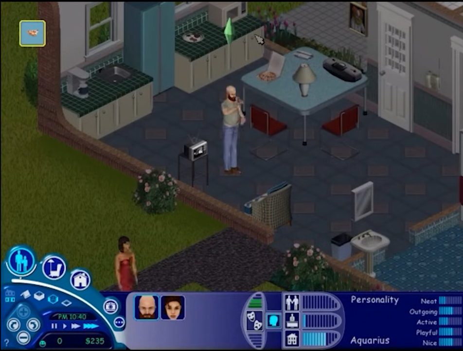
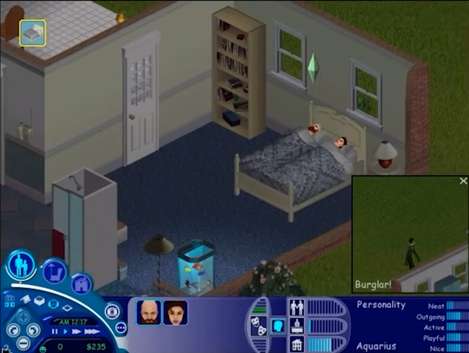
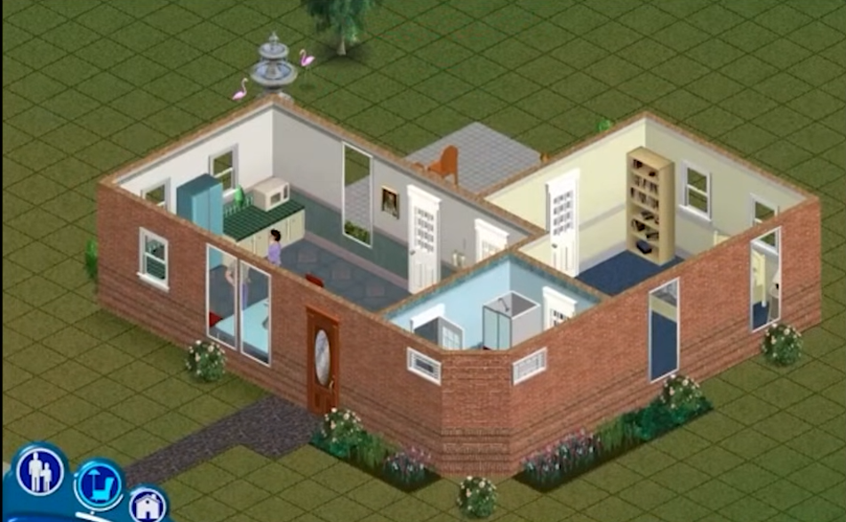

# Especificação da Implementação

> [!CAUTION]
>
> - Você <ins>**não pode utilizar ferramentas de IA para escrever esta
>   especificação**</ins>

> [!WARNING]
>
> - Após a entrega da primeira versão completa, esta especificação não
>   poderá ser alterada. A implementação final deverá corresponder ao que
>   estiver descrito neste arquivo.

## Integrantes da dupla

- **Aluno 1 - Nome**: <mark>`Karina Ribeiro Martins`</mark>
- **Aluno 1 - Cartão UFRGS**: <mark>`00590451`</mark>

- **Aluno 2 - Nome**: <mark>`Antônio Augusto Specht`</mark>
- **Aluno 2 - Cartão UFRGS**: <mark>`00595092`</mark>

## Detalhes do que será implementado

- **Título do trabalho**: <mark>`The Simsmulator`</mark>
- **Parágrafo curto descrevendo o que será implementado**: <mark>`Implementação do jogo The Sims 1. A ideia é fazer que o personagem tenha ações como comer, dormir, ir ao banheiro, entre outras acções. O ambiente onde irá se passar o jogo será na casa do personagem.`</mark>

## Especificação visual

### Vídeo - Link

> [!IMPORTANT]
>
> - Coloque aqui um link para um vídeo que mostre a aplicação gráfica
>   de referência que você vai implementar. **Sua implementação deverá
>   ser o mais parecido possível com o que é mostrado no vídeo (mais
>   detalhes abaixo).**
> - **Você não pode escolher como referência: (1) algum trabalho realizado
>   por outros alunos desta disciplina, em semestres anteriores. (2) Minecraft.**
> - Por exemplo, você pode colocar um vídeo de um jogo que você gosta,
>   e seu trabalho final será uma re-implementação do jogo.
> - O vídeo pode ser um link para YouTube, Google Drive, ou arquivo mp4 dentro
>   do próprio repositório. Mas, garanta que qualquer um tenha
>   permissão de acesso ao vídeo através deste link.

<mark>`https://youtu.be/RdVis25dXJk?si=rwEi_7I2MQ10F2OU`</mark>

### Vídeo - Timestamp

> [!IMPORTANT]
>
> - Coloque aqui um **intervalo de ~30 segundos** do vídeo acima, que
>   será a base de comparação para avaliar se o seu trabalho final
>   conseguiu ou não reproduzir a referência.

- **Timestamp inicial**: <mark>`20:22`</mark>
- **Timestamp final**: <mark>`20:40`</mark>

### Imagens

> [!IMPORTANT]
>
> - Coloque aqui **três imagens** capturadas do vídeo acima, que você
>   irá usar como ilustração para as explicações que vêm abaixo.
> - As imagens devem estar armazenadas neste repositório, no diretório
>   `images/spec/`, com os nomes `image1`, `image2` e `image3`.
> - Cada imagem deve usar o formato `.jpg` ou `.png`. Ajuste a extensão
>   nos vínculos abaixo para que corresponda ao arquivo armazenado.
> - Escolha imagens que correspondam a momentos do intervalo indicado
>   acima ou que sejam relevantes para a comparação com a implementação.

#### Imagem 1

- **Descrição**: <mark>`Personagem comendo pizza`</mark>

#### Imagem 2

- **Descrição**: <mark>`Personagens dormindo em uma cama`</mark>

#### Imagem 3

- **Descrição**: <mark>`Visão de cima da casa do personagem`</mark>

## Especificação textual

Para cada um dos requisitos abaixo (detalhados no [Enunciado do Trabalho final - Moodle](https://moodle.ufrgs.br/mod/assign/view.php?id=6302370)), escreva um parágrafo **curto** explicando como este requisito será atendido, apontando itens específicos do vídeo/imagens que você incluiu acima que atendem estes requisitos.

### Malhas poligonais complexas

<mark>`Tera modelos geométricos de móveis na casa onde será representado por malhas poligonais, assim como a intereção deles entre si. Ex: Ter uma mesa no chão e em cima dela ter um vaso de planta, copo, entre outros.`</mark>

### Transformações geométricas controladas pelo usuário

<mark>`A tecla Tab ativa o modo decoração, no qual a câmera vai para a visão de cima mostrada na Imagem 3 e o usuário reposiciona os móveis. Duas transformações ficam sob controle direto do usuário:

Translação — feita com o mouse. Com um móvel selecionado, ele acompanha continuamente o ponto em que o raio lançado a partir do cursor intersecta o plano do chão (y = 0).
Rotação — feita com o teclado.
O clique esquerdo confirma a posição e Esc cancela, devolvendo o móvel à posição anterior. Cada móvel carrega sua própria matriz; o usuário altera T e R, enquanto S permanece fixo para preservar a escala original do modelo. Antes de confirmar, a nova posição é validada pelo teste AABB × AABB descrito na seção de intersecções: havendo sobreposição com outro móvel, o objeto é desenhado em tom avermelhado e a confirmação é bloqueada.`</mark>

### Diferentes tipos de câmeras

<mark>`Teremos a câmera de visão livre e uma focal onde ao selecionar o persongem seguimos as acões que ele faz pela casa.`</mark>

### Instâncias de objetos

<mark>`Teremos mais de um móvel do mesmo tipo, que poderá ser rotacionado em diferentes posições`</mark>

### Testes de intersecção

<mark>`O personagem irá seguir seu caminho delimitado pela sua casa, ou seja, ele irá andar ou interagir só onde será possível`</mark>

### Modelos de Iluminação em todos os objetos

<mark>`Todos os objetos da cena são iluminados com dois modelos distintos:

Difuso de Lambert — paredes, piso, gramado do jardim e superfícies de tecido, entre outros.
Blinn-Phong — superfícies com brilho especular visível: a pia, a bancada da cozinha, a tela da televisão e as maçanetas das portas.`</mark>

### Mapeamento de texturas em todos os objetos

<mark>`## Mapeamento de Texturas

| Objeto                            | Textura                          |
| :-------------------------------- | :------------------------------- |
| **Piso interno**                  | Cerâmica (imagem, com repetição) |
| **Paredes externas**              | Tijolo (imagem, com repetição)   |
| **Mesa, cadeiras, estante, cama** | Madeira (imagem)                 |
| **Edredom e estofados**           | Tecido (imagem)                  |
| **Gramado do jardim**             | Grama (imagem, com repetição)    |
| **Bancada e pia**                 | Granito (imagem)                 |

São seis imagens distintas. O piso, as paredes de tijolo e o gramado usam GL_REPEAT com coordenadas UV multiplicadas por um fator de tiling, evitando esticar a imagem em superfícies grandes, é a repetição que se observa no piso da cozinha na Imagem 1 e no gramado da Imagem 3.

Origem dos assets: as texturas virão do ambientCG e do Poly Haven, ambos CC0. Os modelos 3D virão do Kenney e do Quaternius, com os objetos restantes modelados no Blender e exportados em obejtos com coordenadas UV.`</mark>

### Movimentação com curva Bézier cúbica

<mark>`A câmera percorre obrigatoriamente uma curva de Bézier cúbica em toda transição entre a câmera livre e a câmera look-at do personagem, acionada pela tecla C. Os quatro pontos de controle são definidos no momento da troca: P0 é a posição atual da câmera, P3 é a posição final junto ao personagem, e P1 e P2 são obtidos elevando e afastando os pontos intermediários, de modo que a câmera descreva um arco por cima da cena em vez de atravessar paredes em linha reta.`</mark>

### Animações baseadas no tempo ($\Delta t$)

<mark>`No laço principal, calculamos o dt a cada quadro para que toda a aplicação rode de forma suave, sem amarrar a velocidade dos movimentos ao framerate. Usamos esse valor para controlar desde a caminhada do personagem e os movimentos de câmera — livres, look-at ou via curvas de Bézier — até as animações dos modelos (como comer e dormir), a abertura de portas e o ciclo de iluminação do dia.`</mark>

### Funcionalidade extra obrigatória

> [!IMPORTANT]
>
> - Descreva a funcionalidade extra relacionada à Computação Gráfica
>   que será implementada.
> - Esta funcionalidade também deverá ser documentada no arquivo
>   `README.md` da entrega final.

<mark>`Mouse picking — seleção e posicionamento dos móveis em 3D com o mouse. A posição do cursor em pixels é convertida para coordenadas normalizadas, elevada a clip space e multiplicada pelas inversas das matrizes de projeção e de vista, produzindo um raio em coordenadas de mundo com origem na câmera.`</mark>

## Limitações esperadas

> [!IMPORTANT]
>
> - Coloque aqui uma lista de detalhes visuais ou de interação que
>   aparecem no vídeo e/ou imagens acima, mas que você **não pretende
>   implementar** ou que você **irá implementar parcialmente**.
> - Para cada item, **explique por que** não será implementado ou por
>   que será implementado parcialmente.

<mark>`Múltiplos personagens e NPCs: a Imagem 2 mostra dois Sims na cama. A aplicação terá apenas um personagem controlável e personagens disputando o mesmo espaço.
Sombras projetadas: sombras dos personagens. A iluminação terá local (Lambert e Blinn-Phong por fragmento), e shadow mapping deve ser a parte mais complicada de implementar.
Detalhamento do jardim: o exterior da Imagem 3 traz fonte, flamingos, árvore e canteiros floridos. O jardim será implementado de forma simplificada, com gramado, calçada e alguns arbustos instanciados, por limitação de tempo de modelagem.
Interação fisicamente precisa com os objetos: o personagem caminha até o móvel e executa a animação correspondente, o problema é a interação do personagem com o objeto ser veridica e não só pegar um item no ar por exemplo.`</mark>
